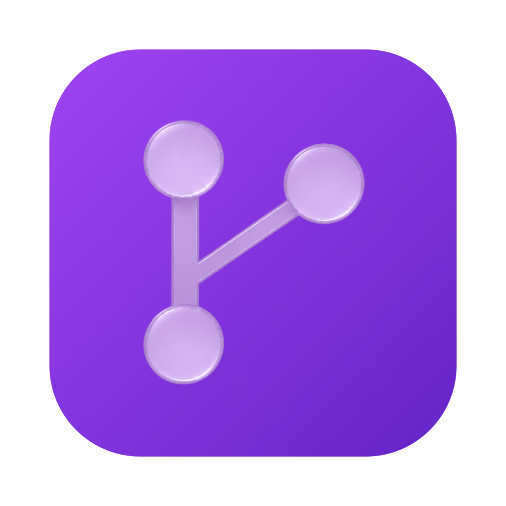
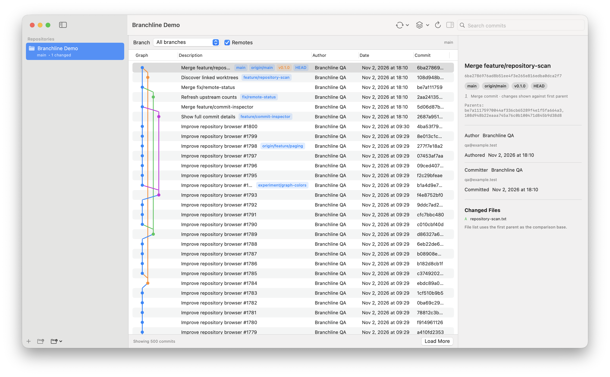

<p align="center">
  
</p>
<h1 align="center">Branchline</h1>
<p align="center"><strong>A native Git history and sync app for macOS.</strong></p>
<p align="center">
  <strong><a href="https://github.com/zackbraksa/branchline/releases/download/v0.1.1/Branchline-0.1.1.dmg">Download Branchline for macOS</a></strong><br>
  macOS 14 or later · Apple silicon and Intel
</p>

Open the disk image and drag **Branchline** to **Applications**. The installer is signed and notarized. See [release notes](https://github.com/zackbraksa/branchline/releases).



Read a commit graph across branches and tags, search history, and inspect a commit’s parents and changed files. Keep repositories and linked worktrees together in the sidebar, with ahead and behind counts for each checkout.

Fetch, pull, or push selected repositories in a batch. Pulls are fast-forward only. Use **Stash & Pull** to save and restore staged, unstaged, and untracked work around a pull. Background fetch is on by default and can be turned off in Settings. You can separately opt in to automatic fast-forward pulls for clean default branches.

Repository data stays on your Mac. Sync uses your existing Git remotes and credentials.

## Build from source

Install Xcode 26 or later, Python 3, and Git on your build machine.

```sh
git clone https://github.com/zackbraksa/branchline.git
cd branchline
./script/build.sh
open dist/Branchline.app
```

The script creates an ad hoc-signed development app with its own local settings and automatic app updates disabled. No Apple Developer account is required.

## Tests

```sh
swift test --disable-sandbox
python3 -B -m unittest discover -s script/tests -v
```

Git integration tests use disposable local repositories and remotes.

## License

[MIT](LICENSE). [Sparkle and its bundled components](SPARKLE-LICENSE.txt) are distributed under their own licenses.
